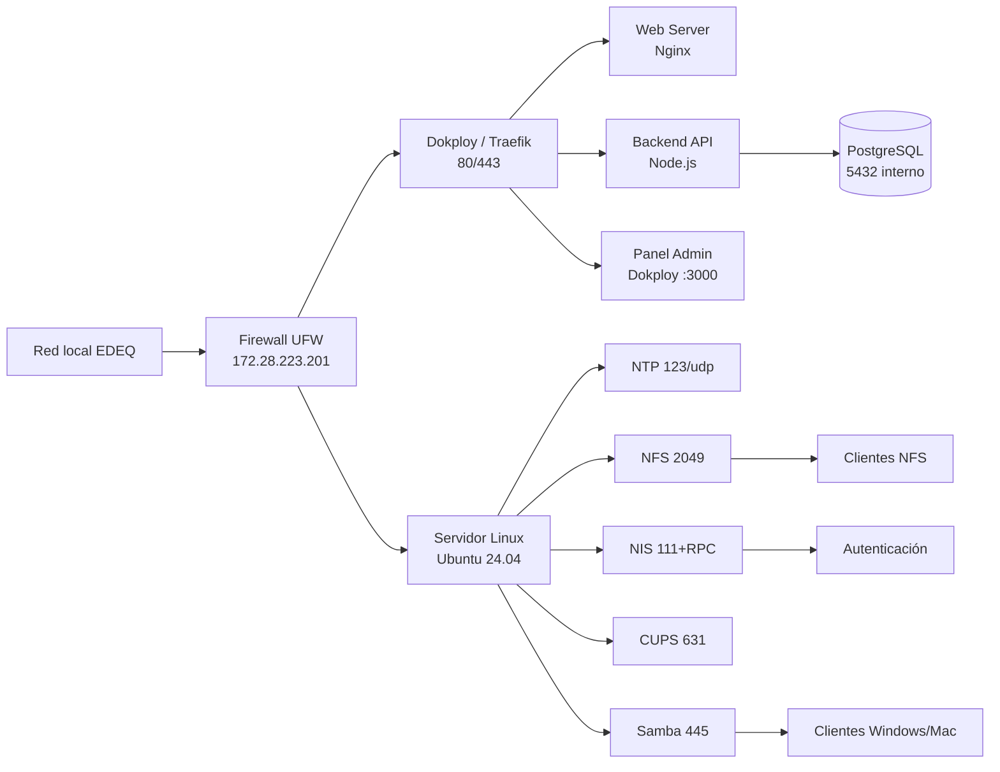

# Análisis y diseño de infraestructura — EDEQ

**Curso:** Administración de Infraestructura de TI — Universidad del Quindío
**Empresa:** Empresa de Energía del Quindío S.A. E.S.P. (EDEQ)
**Nota:** proyecto académico. El sitio y los datos son simulados; no representan sistemas reales de la empresa.

## 1. Contexto de la empresa

EDEQ distribuye y comercializa energía eléctrica en los 12 municipios del Quindío y hace parte del Grupo EPM. Atiende a más de 213.000 clientes (89 % residenciales y 11 % comerciales e industriales) y buena parte de su red (81 %) sirve a una población rural pequeña, lo que implica personal técnico en campo y oficinas distribuidas ([El Tiempo, contenido comercial](https://www.eltiempo.com/contenido-comercial/edeq-energia-para-un-territorio-diverso-763462); es contenido patrocinado, refleja la visión de la empresa).

Según el documento de buenas prácticas Andesco/SSPD 2021, la empresa ya atiende por portal web de PQR (de 56 a 381 solicitudes mensuales), chat web, videollamada, puntos de pago y canales telefónicos, y tuvo que adoptar el teletrabajo ([Superservicios](https://www.superservicios.gov.co/sites/default/files/inline-files/BP-ANDESCO-SSPD-002-2021%20Somos%20la%20energ%C3%ADa%20que%20mueve%20el%20desarrollo%20del%20Quind%C3%ADo.pdf)).

No encontramos datos públicos sobre número de empleados ni de sedes, así que **asumimos** una oficina de unos 30 equipos para dimensionar el proyecto.

## 2. Necesidades y justificación de cada servicio

| Necesidad de EDEQ | Servicio | Justificación |
|---|---|---|
| Publicar información y canales de atención (portal, PQR, reporte de fallas) | **Web (Nginx) + Backend API + PostgreSQL**, desplegados con Dokploy | La empresa ya depende de canales web. Dokploy permite desplegar, actualizar y dar HTTPS a cada aplicación sin configuración manual. |
| Administrar las aplicaciones de forma centralizada | **Dokploy / Traefik** | Un solo panel para despliegues, dominios, certificados, bases de datos y copias de seguridad. |
| Registros de consumo, facturación y reportes coherentes entre equipos | **NTP** | Facturas, órdenes de trabajo y logs necesitan la misma hora. Sin sincronía fallan certificados, Kerberos/NIS y la auditoría. |
| Compartir documentos técnicos y planos entre equipos Linux | **NFS** | Directorio común montado en los equipos de operación sin copiar archivos. |
| Una sola cuenta por empleado en los equipos Linux | **NIS** | Altas, bajas y cambios de contraseña en un solo lugar; el usuario entra con la misma cuenta desde cualquier equipo. |
| Impresión de facturas, órdenes y oficios | **CUPS** | Una cola de impresión central en vez de configurar cada equipo; control de quién imprime. |
| Carpetas compartidas para el área administrativa y comercial con Windows/Mac | **Samba** | Los equipos de oficina usan Windows/Mac; Samba expone una carpeta protegida por usuario y grupo. |

Decisiones de diseño:

- **Un solo servidor Ubuntu 24.04** aloja Dokploy y los servicios tradicionales, porque el enunciado habla de "un servidor local". El costo es un único punto de falla; se mitiga con backups y se documenta como riesgo.
- **NIS en lugar de LDAP:** lo exige el enunciado. NIS es sencillo pero transmite sin cifrar, por eso solo se usa dentro de la red interna y se limita con firewall.
- **PostgreSQL sin puerto público:** solo la API lo alcanza por la red interna de Docker.
- **Certificado autofirmado** para HTTPS, con dominio local en el archivo hosts: Let's Encrypt exige un dominio público alcanzable desde Internet. Es una limitación del laboratorio y se documenta.

## 3. Plan de direccionamiento (supuesto)

> Las IP son las asignadas por el switch de Hyper-V (Multipass) por DHCP. Pueden cambiar si se reinicia el equipo anfitrión; ver riesgos.

| Equipo | Nombre | IP | Rol |
|---|---|---|---|
| Servidor | `edeq-srv` | 172.28.223.201 | Dokploy + NTP + NFS + NIS + CUPS + Samba |
| Cliente Linux | `edeq-cli` | 172.28.208.172 | Pruebas de NTP, NFS, NIS |
| Cliente Windows | equipo anfitrión | DHCP | Pruebas de Samba, CUPS y web |

Subred de las VM: `172.28.208.0/20`.

Dominio local: `edeq.local` (sitio en `www.edeq.local`, panel en `panel.edeq.local`, API en `api.edeq.local`), resueltos con hosts.

## 4. Tabla de requisitos de servicios

| Servicio | Software | IP | Puerto | Protocolo | Tipo | Acceso |
|---|---|---|---|---|---|---|
| Panel Dokploy | Dokploy | 172.28.223.201 | 3000 | TCP | Plataforma | Administradores |
| Proxy inverso | Traefik | 172.28.223.201 | 80, 443 | TCP | Plataforma | Red local |
| Web | Nginx (contenedor) | 172.28.223.201 | 443 vía Traefik | HTTPS | Aplicación | Red local |
| Backend API | Node.js (contenedor) | 172.28.223.201 | 443 vía Traefik | HTTPS | Aplicación | Red local |
| Base de datos | PostgreSQL (Dokploy) | red interna Docker | 5432 | TCP | Datos | Solo la API |
| NTP | ntpsec (paquete `ntp`) | 172.28.223.201 | 123 | UDP | Infraestructura | Red local |
| NFS | nfs-kernel-server | 172.28.223.201 | 2049 (y 111 rpcbind) | TCP/UDP | Archivos | Clientes Linux |
| NIS | ypserv (`nis`) | 172.28.223.201 | 111 + puertos RPC dinámicos | TCP/UDP | Autenticación | Clientes Linux |
| CUPS | cups | 172.28.223.201 | 631 | TCP (IPP) | Impresión | Red local |
| Samba | samba | 172.28.223.201 | 139, 445 | TCP | Archivos | Windows/Mac |
| SSH | OpenSSH | 172.28.223.201 | 22 | TCP | Administración | Administradores |

Las reglas UFW se derivan de esta tabla: se permite solo lo listado y desde la subred local.

## 5. Recursos de las máquinas virtuales

| VM | vCPU | RAM | Disco | SO |
|---|---|---|---|---|
| `edeq-srv` | 2 | 4 GB | 40 GB | Ubuntu Server 24.04 |
| `edeq-cli` | 1 | 1 GB | 10 GB | Ubuntu Server 24.04 |

## 6. Diagrama de arquitectura

El código fuente está en [`diagrama.mmd`](diagrama.mmd); la imagen renderizada en `capturas/diagrama.png`.

## 7. Riesgos y limitaciones

- Servidor único: si cae, caen todos los servicios. Mitigación: backup automático de la base de datos y de los directorios compartidos.
- NIS no cifra el tráfico; se restringe a la red local.
- El certificado autofirmado genera advertencia en el navegador; en producción se usaría un dominio público con Let's Encrypt.
- Las IP dependen del DHCP del switch de Hyper-V y pueden cambiar tras reiniciar Windows; se ajusta el archivo hosts. La guía pide red en modo puente, pero con Multipass/Hyper-V no fue estable en este equipo.
- Sin impresora física, CUPS se prueba con una impresora virtual (PDF).
- RAM del equipo anfitrión limitada: las dos VM deben ejecutarse juntas solo durante las pruebas.
