# Documentación — Infraestructura de TI para EDEQ

Universidad del Quindío — Administración de Infraestructura de TI.
Integrantes: Juan Esteban Arango, Karen Reyes, Shara Bedoya
Repositorio: https://github.com/JuanesArangoi/proyecto-final-edeq

> Proyecto académico.

## 1. Entorno

| Elemento | Valor |
|---|---|
| Hipervisor | Multipass sobre Hyper-V (Windows) |
| Servidor | `edeq-srv`, Ubuntu Server 24.04.5, 2 vCPU, 4 GB RAM, 40 GB disco, IP 172.28.223.201 |
| Cliente Linux | `edeq-cli`, Ubuntu Server 24.04, 1 vCPU, 512 MB RAM, 8 GB disco, IP 172.28.208.172 |
| Cliente Windows | Equipo anfitrión (Samba, CUPS, navegador) |
| Subred | 172.28.208.0/20 (DHCP del switch de Hyper-V) |
| Dominio local | `edeq.local` → `panel.`, `www.`, `api.` (archivo hosts de Windows) |

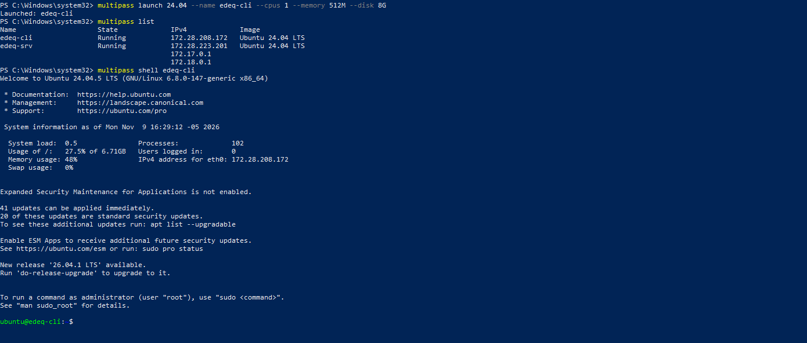

Desviaciones frente a la guía, con su razón:

- **Hipervisor:** la guía menciona VirtualBox o VMware; se usó Multipass sobre Hyper-V porque ya estaba instalado y funcionando en el equipo.
- **Red:** la guía pide red en modo puente con IP estática. El switch de Hyper-V entrega IP por DHCP y la subred puede cambiar si se reinicia Windows; si ocurre se actualizan el archivo hosts y las reglas que usan la subred.
- **Cliente con 512 MB:** el equipo anfitrión tiene ~7,9 GB de RAM y con 4 GB para el servidor no alcanzó para 1 GB en el cliente (error `0x8007000E` al crearlo).

## 2. Servidor base

```
multipass launch 24.04 --name edeq-srv --cpus 2 --memory 4G --disk 40G
sudo apt update && sudo DEBIAN_FRONTEND=noninteractive apt -y upgrade
sudo timedatectl set-timezone America/Bogota
sudo apt install -y curl net-tools dnsutils ufw
```

Verificación: `hostnamectl`, `timedatectl`, `hostname -I`.
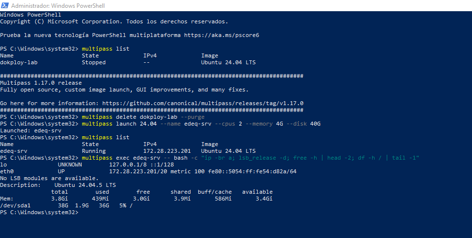

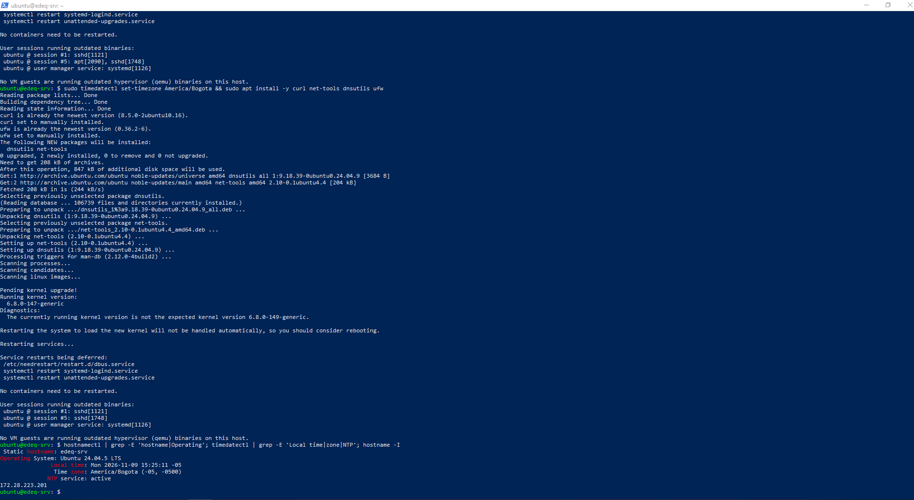

## 3. Dokploy, dominio y SSL (Semana 2)

### 3.1 Instalación

```
sudo ss -tlnp | grep -E ':(80|443|3000)\s' || echo "puertos libres"
curl -sSL https://dokploy.com/install.sh | sudo ADVERTISE_ADDR=172.28.223.201 sh
sudo docker ps --format 'table {{.Names}}\t{{.Status}}\t{{.Ports}}'
```

Se fija `ADVERTISE_ADDR` para que Docker Swarm use la IP correcta de la VM. Quedan en ejecución `dokploy`, `dokploy-postgres` y `dokploy-traefik`. Panel: `http://172.28.223.201:3000`.
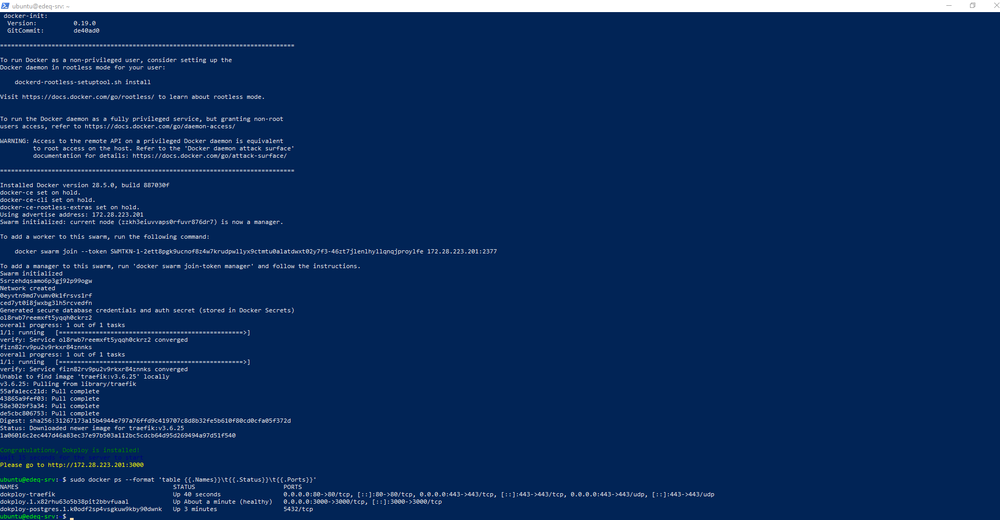

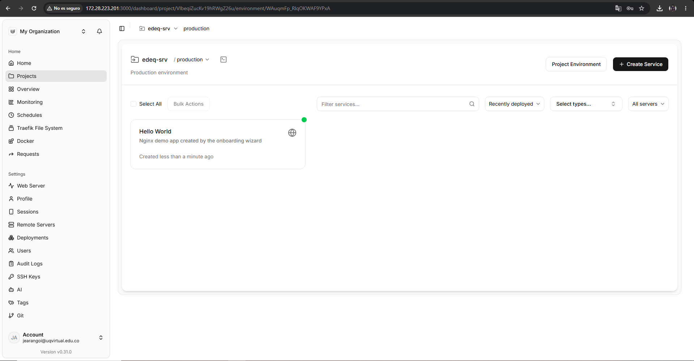

### 3.2 Dominio local

En Windows (PowerShell como administrador):

```
Add-Content C:\Windows\System32\drivers\etc\hosts "172.28.223.201 panel.edeq.local www.edeq.local api.edeq.local"
ping panel.edeq.local -n 1
```

No se usó dominio gratuito ni DNS dinámico porque la VM no es alcanzable desde Internet; el archivo hosts resuelve los nombres dentro de la red local.

### 3.3 Certificado SSL/TLS autofirmado

```
mkdir -p ~/certs && cd ~/certs
openssl req -x509 -nodes -newkey rsa:2048 -days 365 -keyout edeq.key -out edeq.crt \
  -subj "/CN=*.edeq.local/O=EDEQ Proyecto Academico" \
  -addext "subjectAltName=DNS:*.edeq.local,DNS:edeq.local"
```

El certificado se cargó en Dokploy (*Settings → Certificates*, nombre `edeq-local`). En *Settings → Web Server* se configuró `panel.edeq.local` con HTTPS. Let's Encrypt no es posible sin dominio público; Traefik sirve el certificado cargado cuando el nombre coincide con `*.edeq.local`.

Verificación:

```
curl -vk --resolve panel.edeq.local:443:127.0.0.1 https://panel.edeq.local 2>&1 | grep -E 'subject:|issuer:|HTTP/'
```

Resultado: `subject: CN=*.edeq.local`, `HTTP/2 200`. El navegador muestra "No es seguro" porque el emisor es el propio certificado.
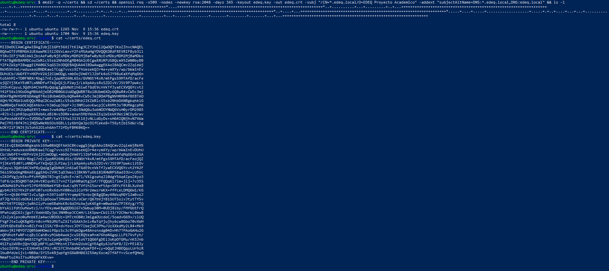

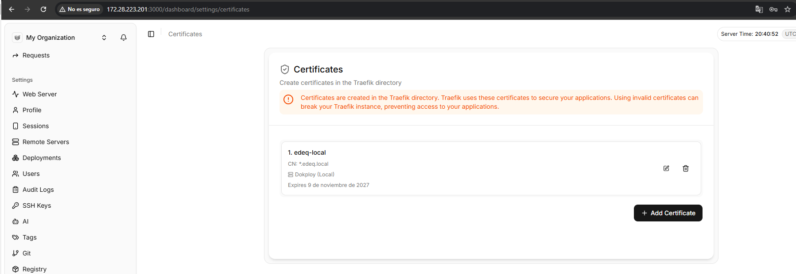

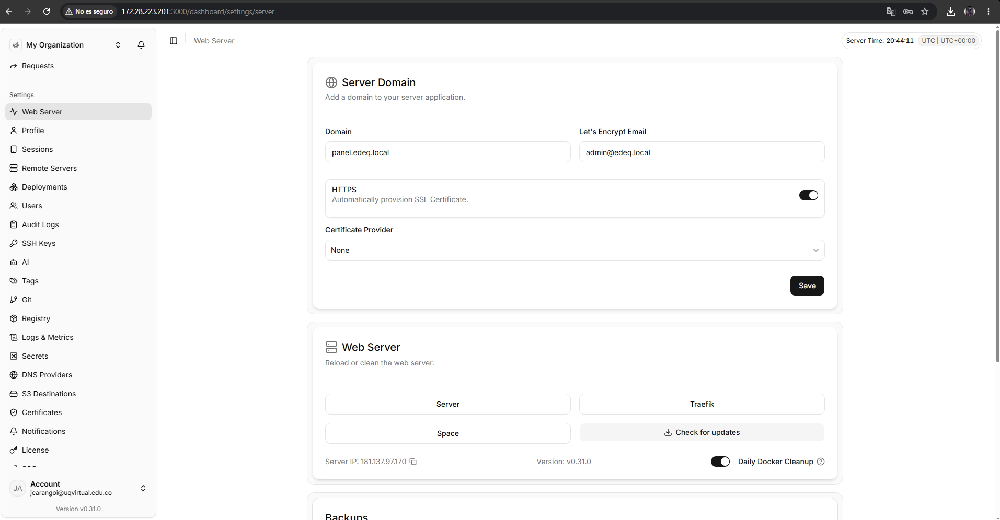

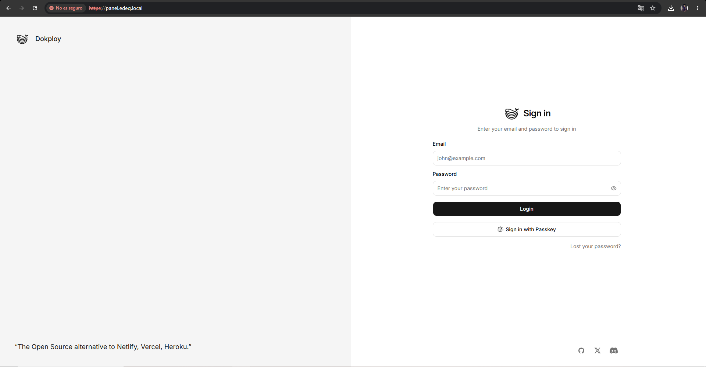

## 4. NTP (Semana 2)

En Ubuntu 24.04 el paquete `ntp` es transitorio y instala `ntpsec`.

```
sudo systemctl disable --now systemd-timesyncd
sudo apt install -y ntp
echo 'pool pool.ntp.org iburst' | sudo tee -a /etc/ntpsec/ntp.conf && sudo systemctl restart ntpsec
```

Verificación:

```
systemctl is-active ntpsec; ntpq -p; ss -ulnp | grep ':123'
```

Resultado: sincronizado con `0.co.ntp.edgeuno.com` (`*`), escuchando en UDP 123.
Cliente (`edeq-cli`):

```
sudo mkdir -p /etc/systemd/timesyncd.conf.d
printf '[Time]\nNTP=172.28.223.201\n' | sudo tee /etc/systemd/timesyncd.conf.d/edeq.conf
sudo systemctl restart systemd-timesyncd && timedatectl timesync-status
```

Resultado: `Server: 172.28.223.201`, `Stratum: 3`, desfase de 1,6 ms.
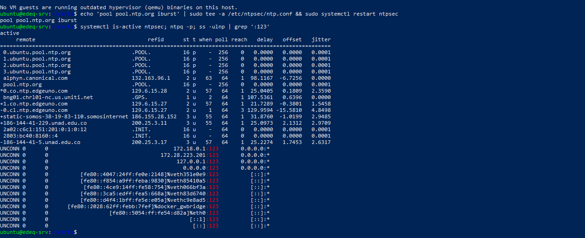

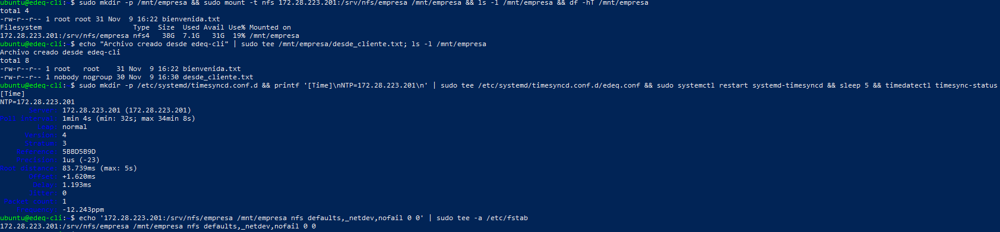

## 5. Web, API y base de datos (Semana 3)

Código en `codigo/`:

- `codigo/web`: sitio en Nginx (`Dockerfile` + `index.html`), formulario de reporte de fallas.
- `codigo/api`: API Node.js/Express con PostgreSQL (`/api/health`, `GET` y `POST /api/reportes`).

En Dokploy, proyecto `edeq`:

1. **Base de datos:** PostgreSQL 16 `edeq-db` (base `edeq`, usuario `edeq`). Host interno `edeq-edeqdb-pr2yim`, sin puerto publicado.
2. **Aplicación `api`:** proveedor Git (`https://github.com/JuanesArangoi/proyecto-final-edeq.git`, rama `main`), build Dockerfile (`codigo/api/Dockerfile`, contexto `codigo/api`), variables `DATABASE_URL` y `PORT=3000`. Dominio `www.edeq.local`, ruta `/api`, puerto 3000, HTTPS.
3. **Aplicación `web`:** igual, con `codigo/web`. Dominio `www.edeq.local`, ruta `/`, puerto 80, HTTPS.

Con ambas bajo el mismo dominio no hace falta CORS.

Verificación:

```
curl -sk --resolve www.edeq.local:443:127.0.0.1 https://www.edeq.local/api/health
sudo docker exec $(sudo docker ps -q -f name=edeqdb) psql -U edeq -d edeq -c "SELECT id, municipio, direccion, estado FROM reportes;"
```

Resultado: `{"api":"ok","base_de_datos":"ok",...}` y los reportes enviados desde el formulario aparecen en la tabla.
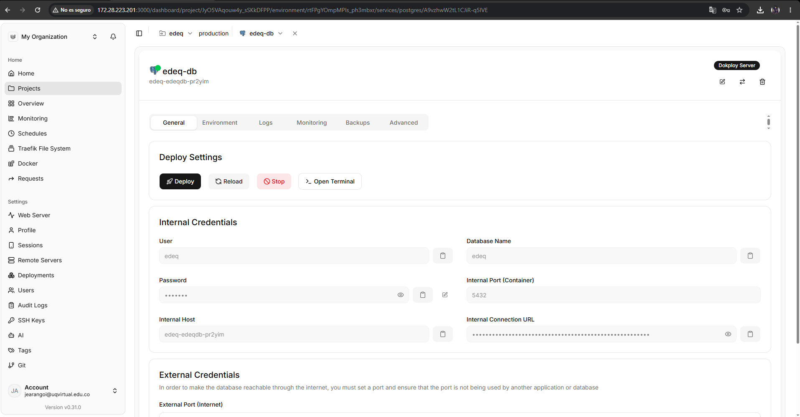

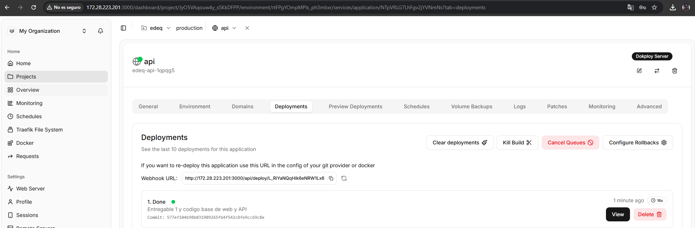

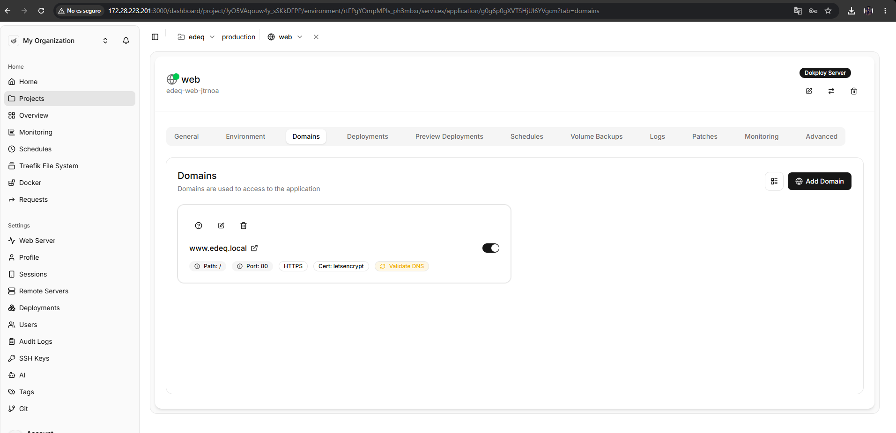

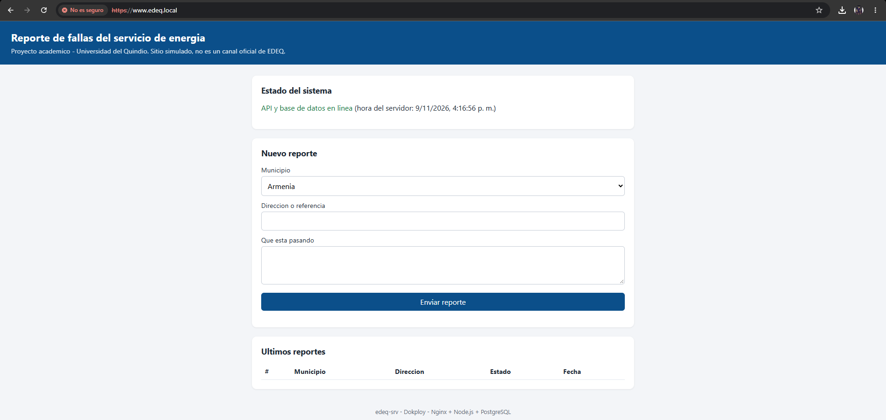

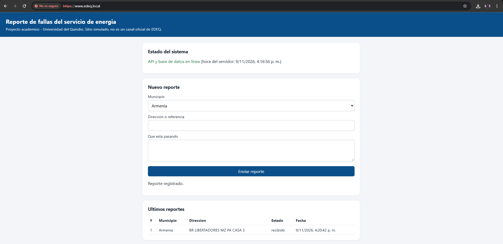

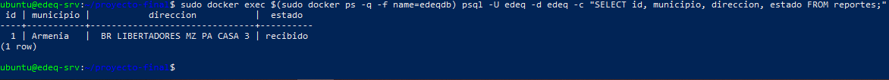

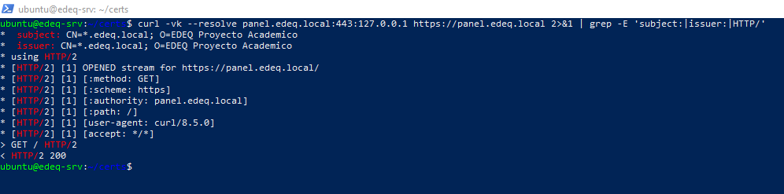

## 6. NFS (Semana 3)

Servidor:

```
sudo apt install -y nfs-kernel-server
sudo mkdir -p /srv/nfs/empresa && sudo chown nobody:nogroup /srv/nfs/empresa && sudo chmod 777 /srv/nfs/empresa
echo '/srv/nfs/empresa 172.28.208.0/20(rw,sync,no_subtree_check)' | sudo tee -a /etc/exports
sudo exportfs -ra && sudo systemctl enable --now nfs-kernel-server
sudo exportfs -v; showmount -e localhost
```

Cliente:

```
sudo apt install -y nfs-common
sudo mkdir -p /mnt/empresa && sudo mount -t nfs 172.28.223.201:/srv/nfs/empresa /mnt/empresa
echo '172.28.223.201:/srv/nfs/empresa /mnt/empresa nfs defaults,_netdev,nofail 0 0' | sudo tee -a /etc/fstab
```

Resultado: montaje `nfs4`, el cliente ve `bienvenida.txt` y crea `desde_cliente.txt`. Se dejó `root_squash` (por defecto) en lugar de `no_root_squash` de la guía, porque este último permite que el root de un cliente actúe como root en el servidor; por eso los archivos creados desde el cliente figuran como `nobody:nogroup`.


## 7. NIS (Semana 3)

Servidor (dominio NIS `edeq.local`):

```
sudo DEBIAN_FRONTEND=noninteractive apt install -y nis
echo 'edeq.local' | sudo tee /etc/defaultdomain && sudo domainname edeq.local
sudo useradd -m -s /bin/bash -u 2001 empleado1 && sudo useradd -m -s /bin/bash -u 2002 empleado2
echo 'empleado1:Edeq2026' | sudo chpasswd && echo 'empleado2:Edeq2026' | sudo chpasswd
sudo sed -i 's/^NISSERVER=.*/NISSERVER=master/' /etc/default/nis
printf '255.0.0.0\t127.0.0.0\n255.255.240.0\t172.28.208.0\n' | sudo tee /etc/ypserv.securenets
sudo sed -i 's/^MINUID=.*/MINUID=2000/; s/^MINGID=.*/MINGID=2000/' /var/yp/Makefile
sudo /usr/lib/yp/ypinit -m
echo 'domain edeq.local server 127.0.0.1' | sudo tee -a /etc/yp.conf
sudo systemctl restart rpcbind ypserv && sudo systemctl restart ypbind yppasswdd
ypwhich; ypcat passwd
```

Se publican solo los usuarios con UID ≥ 2000 para no exponer la cuenta `ubuntu`. Las contraseñas de prueba son de laboratorio.

Cliente:

```
sudo DEBIAN_FRONTEND=noninteractive apt install -y nis
echo 'edeq.local' | sudo tee /etc/defaultdomain && sudo domainname edeq.local
echo 'domain edeq.local server 172.28.223.201' | sudo tee -a /etc/yp.conf
sudo sed -i -E 's/^(passwd|group|shadow):(.*)$/\1:\2 nis/' /etc/nsswitch.conf
sudo pam-auth-update --enable mkhomedir
sudo systemctl enable --now rpcbind ypbind && sudo systemctl restart ypbind
ypwhich; ypcat passwd; id empleado1; su - empleado1
```

Resultado: `ypwhich` → `172.28.223.201`; `id empleado1` resuelve un usuario que no existe localmente; `su - empleado1` autentica y crea `/home/empleado1`. Nota: la guía propone `ypinfo --self`, que no es un comando válido; se usaron `ypwhich` y `ypcat`.
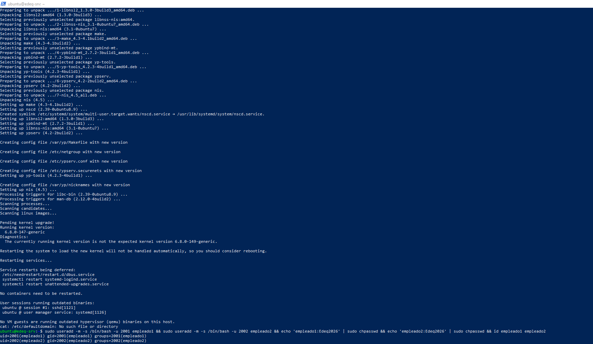

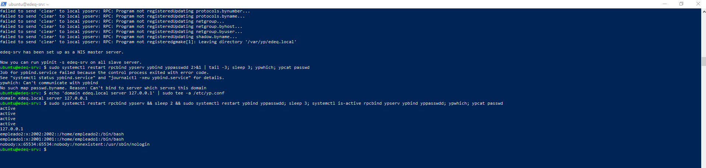

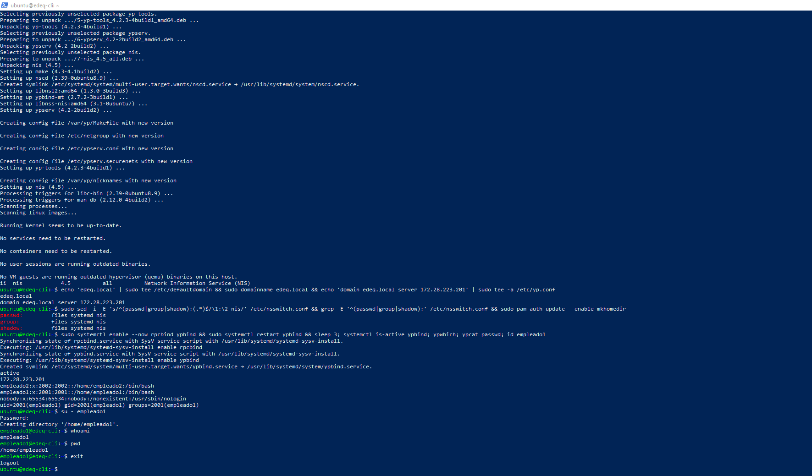

## 8. CUPS (Semana 3)

Sin impresora física se usó una impresora virtual PDF (`cups-pdf`).

```
sudo apt install -y cups cups-pdf && sudo usermod -aG lpadmin empleado1 && sudo systemctl enable --now cups
sudo cupsctl --remote-admin --remote-any --share-printers && sudo systemctl restart cups
sudo lpadmin -p PDF -o printer-is-shared=true
lpstat -p -d; ss -tlnp | grep ':631'
echo "Prueba de impresion EDEQ" | lp -d PDF
ls -l ~/PDF
```

Resultado: la cola `PDF` está habilitada y compartida, escucha en el puerto 631, el trabajo `PDF-1` quedó completado y el PDF se generó en `~/PDF` (en Ubuntu 24.04 el destino por defecto es `${HOME}/PDF`). Interfaz web: `https://172.28.223.201:631/printers/`.
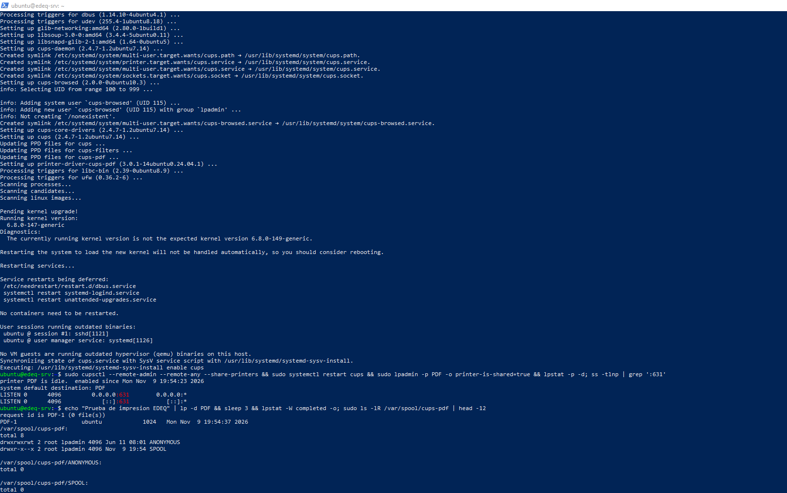

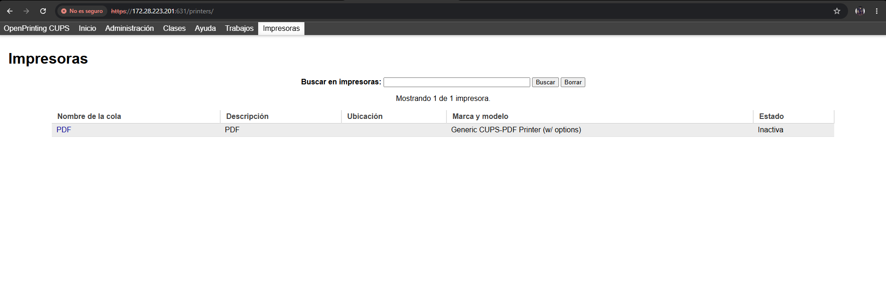

## 9. Samba (Semana 3)

```
sudo apt install -y samba smbclient
sudo groupadd sambausers && sudo usermod -aG sambausers empleado1 && sudo usermod -aG sambausers empleado2
sudo mkdir -p /srv/samba/empresa && sudo chgrp sambausers /srv/samba/empresa && sudo chmod 2770 /srv/samba/empresa
printf '\n[empresa]\n   path = /srv/samba/empresa\n   browseable = yes\n   writable = yes\n   guest ok = no\n   valid users = @sambausers\n   create mask = 0660\n   directory mask = 2770\n' | sudo tee -a /etc/samba/smb.conf
printf 'Edeq2026\nEdeq2026\n' | sudo smbpasswd -a -s empleado1
printf 'Edeq2026\nEdeq2026\n' | sudo smbpasswd -a -s empleado2
sudo systemctl enable --now smbd nmbd && sudo systemctl restart smbd nmbd
smbclient //localhost/empresa -U empleado1%Edeq2026 -c 'put /etc/hostname prueba_samba.txt; ls'
smbclient //localhost/empresa -N -c ls
```

Resultado: con credenciales se sube y lista el archivo; sin credenciales sale `NT_STATUS_ACCESS_DENIED`.
Desde Windows:

```
net use Z: \\172.28.223.201\empresa /user:empleado1 Edeq2026
dir Z:\
```

Resultado: se ve `prueba_samba.txt` y se puede escribir desde Windows.
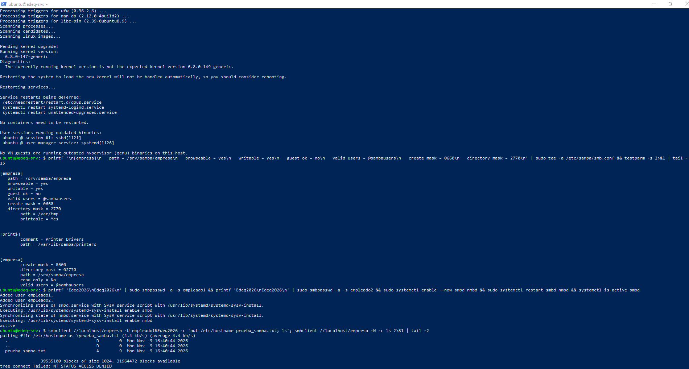

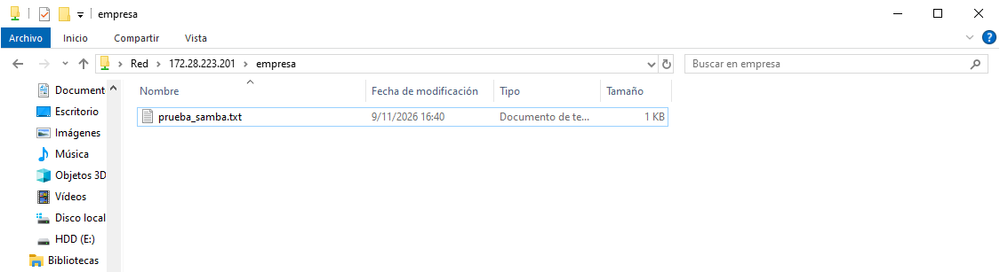

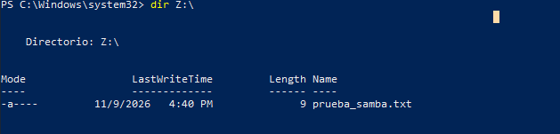

## 10. Extras

### 10.1 Firewall UFW

Por defecto se deniega lo entrante y solo se permiten los puertos de la tabla de requisitos, desde la subred `172.28.208.0/20`. NIS usa un puerto RPC dinámico, así que se fijó el de `ypserv`:

```
sudo sed -i 's/^YPSERVARGS=.*/YPSERVARGS="-p 1011"/' /etc/default/nis && sudo systemctl restart ypserv
sudo ufw default deny incoming && sudo ufw default allow outgoing
sudo ufw allow from 172.28.208.0/20 to any port 22 proto tcp
for p in 80 443 3000 631 139 445 2049 1011; do sudo ufw allow from 172.28.208.0/20 to any port $p proto tcp; done
for p in 123 111 2049 1011 137 138; do sudo ufw allow from 172.28.208.0/20 to any port $p proto udp; done
sudo ufw allow from 172.28.208.0/20 to any port 111 proto tcp
sudo ufw --force enable && sudo ufw status numbered
```

Se comprobó después que web, API, NIS, NFS, NTP y Samba siguen funcionando. Limitación: Docker publica los puertos 80, 443 y 3000 con sus propias reglas de `iptables`, que no pasan por UFW; para esos tres puertos el filtro por subred no es total.
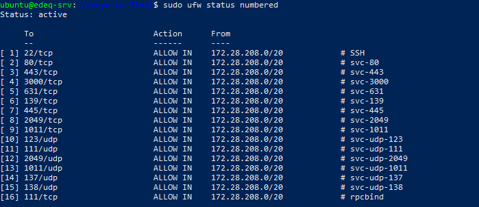

### 10.2 Copia de seguridad automática

`codigo/scripts/backup_edeq.sh` hace `pg_dump` de la base `edeq` a `/srv/backups/edeq/`, comprime y conserva 7 días. Cron diario a las 2:00 a. m. (`/etc/cron.d/edeq-backup`). Prueba de restauración: la copia se cargó en una base temporal `edeq_restore` y devolvió el mismo número de reportes (2).
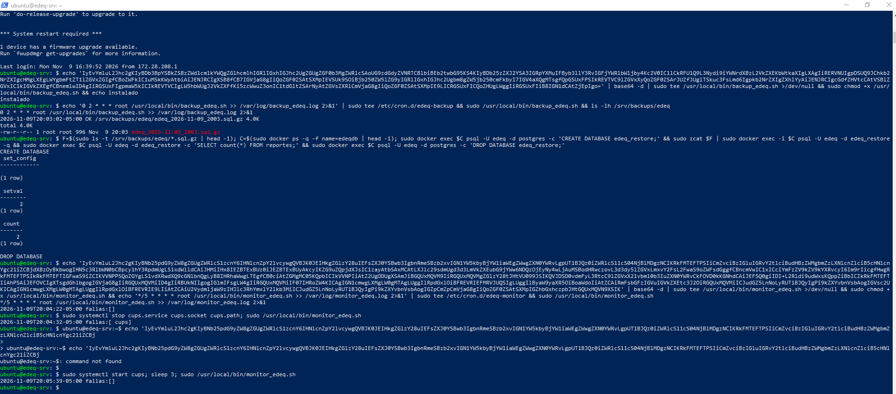


### 10.3 Monitoreo con alertas

`codigo/scripts/monitor_edeq.sh` corre cada 5 minutos (`/etc/cron.d/edeq-monitor`). Revisa `docker`, `ntpsec`, `nfs-server`, `ypserv`, `smbd`, `cups`, la API con su base de datos y el uso del disco (≥ 85 %). Envía una notificación por ntfy solo cuando cambia el estado. Prueba: al detener CUPS llegó "EDEQ ALERTA — Fallas en edeq-srv: cups" y al iniciarlo "EDEQ OK — Servicios restablecidos".
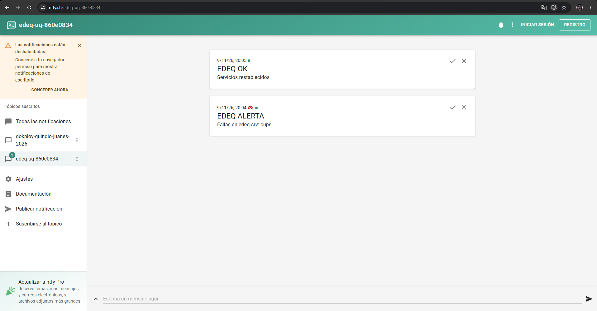

### 10.4 Repositorio y control de versiones

El proyecto vive en un repositorio Git con la estructura pedida (`analisis.md`, `diagrama.mmd`, `documentacion.md`, `README.md`, `capturas/`, `codigo/`). Dokploy despliega `web` y `api` directamente desde la rama `main`, de modo que un cambio en el código se publica con un nuevo *Deploy*.

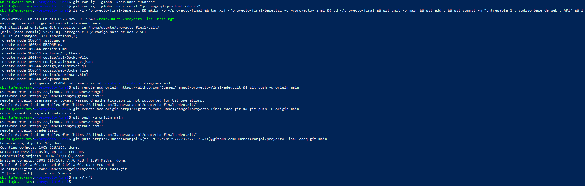

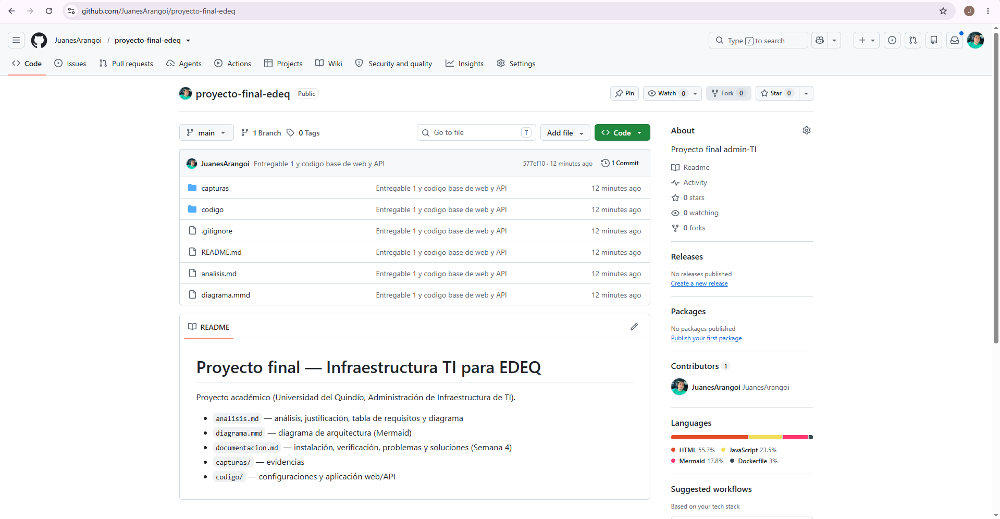

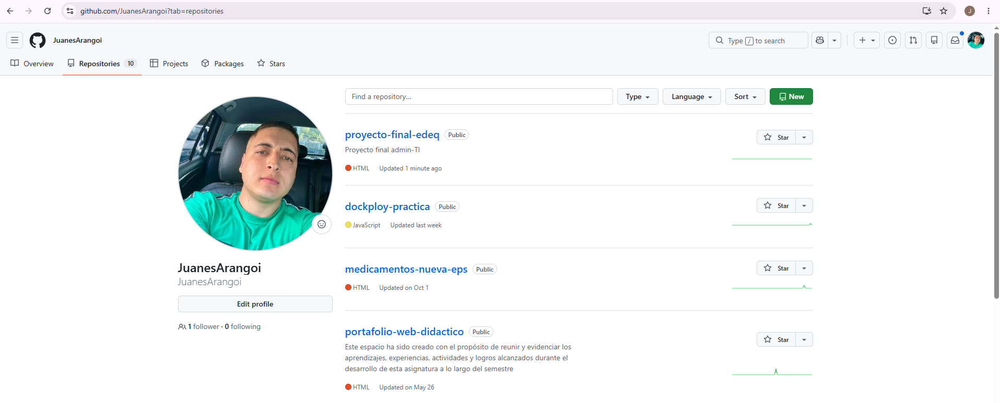

## 11. Problemas y soluciones

| Problema | Causa | Solución |
|---|---|---|
| `multipass launch` del cliente falló con `0x8007000E` | El anfitrión (~7,9 GB RAM) no tenía memoria libre con el servidor de 4 GB encendido | Cerrar Docker Desktop, `wsl --shutdown` y crear el cliente con 512 MB |
| `ping` al dominio local correcto pero dudas con el archivo hosts | El chat mostraba el nombre como enlace de markdown | Reescribir la línea y comprobar con `[System.Net.Dns]::GetHostAddresses()` |
| `ypinit` dijo "domain name hasn't been set" | La preconfiguración de `debconf` no dejó el dominio guardado | Escribir `/etc/defaultdomain` y ejecutar `domainname edeq.local` |
| `ypbind` falló en el servidor | `/etc/yp.conf` sin servidor definido | Añadir `domain edeq.local server 127.0.0.1` |
| Dokploy: "Remote branch Main not found" | La rama se escribió con mayúscula | Usar `main` en minúscula |
| `git push` rechazado: "Invalid username or token" y no dejaba pegar la clave | Token mal copiado y la terminal no aceptaba el pegado | Pasar el token en un archivo temporal, hacer el push con `$(cat ...)` y borrar el archivo |
| `cups-pdf` no dejaba el PDF en `/var/spool/cups-pdf` | En Ubuntu 24.04 el destino es `${HOME}/PDF` | Revisar `/etc/cups/cups-pdf.conf` (`Out`) |
| La guía usa `ypinfo --self` | Comando inexistente | `ypwhich` y `ypcat passwd` |
| `ntp` en Ubuntu 24.04 | Paquete transitorio hacia `ntpsec` | Configurar `/etc/ntpsec/ntp.conf` y servicio `ntpsec` |
| Let's Encrypt no aplica | Dominio local sin acceso desde Internet | Certificado autofirmado cargado en Dokploy |

## 12. Análisis costo-beneficio

Costos de licencias:

- Todo el software usado es de código abierto (Ubuntu Server, Dokploy, Docker, Traefik, Nginx, Node.js, PostgreSQL, NTPsec, NFS, NIS, CUPS, Samba): costo de licencias de software **cero**.
- Una alternativa basada en Windows Server obligaría a pagar licencia del servidor y licencias de acceso de cliente (CAL) por usuario o dispositivo, y servicios equivalentes (directorio, archivos, impresión) se licencian aparte. 

Costos de operación: hardware de un servidor físico o virtual, energía, y el tiempo de un administrador. La administración es por línea de comandos, lo que exige personal con experiencia en Linux.

Beneficios: centralización de web, archivos, impresión, hora y usuarios en una sola plataforma; despliegues repetibles con Dokploy; copia de seguridad y monitoreo automáticos; facilidad para crecer (se pueden añadir aplicaciones sin tocar el sistema base).

Riesgos y mitigaciones:

- Servidor único: una falla afecta a todos los servicios. Mitigación: copias diarias y alertas; en producción, un segundo servidor.
- NIS no cifra el tráfico: se restringe a la red local con UFW y `ypserv.securenets`; en producción se recomendaría LDAP con TLS o Kerberos.
- Certificado autofirmado: en producción, dominio público y Let's Encrypt.

